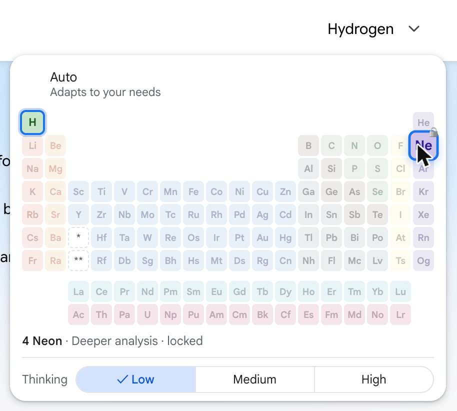

# Gemini Periodic Table Model Picker

A Tampermonkey userscript that swaps Gemini's model dropdown for a tiny periodic table.
Gemini 4's models are named after elements (Hydrogen, Neon, …), so the picker might as well be a periodic table too.

It only changes how the picker looks. Every pick goes through Gemini's own menu, so the model and thinking level you choose are what Gemini actually uses.

## Install

1. Install the [Tampermonkey](https://www.tampermonkey.net/) extension for your browser.
2. **Chrome / Edge only:** userscripts need an extra permission.
   Open `chrome://extensions`, then either turn on **Developer mode** (top right), or open Tampermonkey's **Details** and turn on **Allow User Scripts**. Which one you need depends on your browser version.
3. Install the script, either way works:
   - **From GitHub:** open [`gemini-periodic-picker.user.js`](gemini-periodic-picker.user.js) and click **Raw**. Tampermonkey opens an install page; click **Install**.
   - **By hand:** Tampermonkey icon → **Create a new script…**, delete the template, paste in the contents of `gemini-periodic-picker.user.js`, then **File → Save**.
4. Reload [gemini.google.com](https://gemini.google.com).

## Use

Click the model pill in the prompt box (the one that says "Hydrogen", "Auto", …).

- **Highlighted elements** are the models your account can use. Click one to switch to it.
- **🔒 Locked elements** need a higher plan. Clicking one does whatever Gemini does, which is usually an upgrade prompt.
- **Greyed-out elements** aren't models (yet).
- **Auto** sits above the table, just like in the stock menu.
- **Thinking: Low / Medium / High** at the bottom sets the thinking depth. The picker stays open so you can set both.
- Hover any element to see its description in the footer. Press **Esc** or click outside to close.

## How it works

- The script catches clicks on the model pill and shows its own popover instead of the stock menu.
- To read options or apply a choice, it opens Gemini's real menu with it hidden, reads it or clicks the matching item, then closes it.
- Models are found by reading the menu text: "4 Hydrogen" becomes the H cell. If Gemini adds Carbon or Argon to your menu, those cells light up on their own.
- Nothing is stored and no network requests are made. Gemini's own state is what counts.

## Troubleshooting

- **Picker shows "Couldn't read Gemini's menu."** Gemini probably changed its page layout. The script looks for `data-test-id="bard-mode-menu-button"` and `data-test-id="gem-mode-menu"`. Disable the script in Tampermonkey to get the stock menu back.
- **Nothing happens when you click the pill.** Check that the script is enabled in Tampermonkey and runs on `https://gemini.google.com/*`. On Chrome, also check the Developer mode / Allow User Scripts step above.

## Disclaimer

This is an unofficial fan project, not affiliated with or endorsed by Google. Gemini is a trademark of Google LLC.
